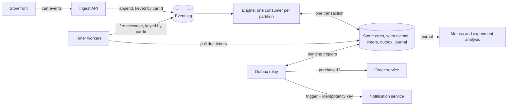
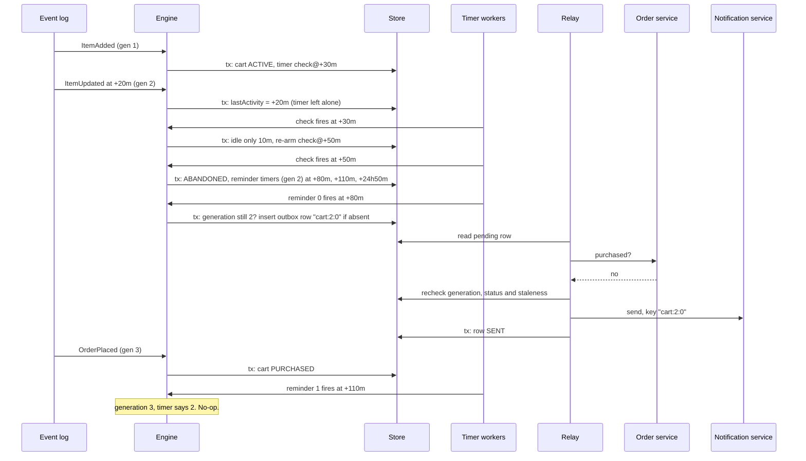
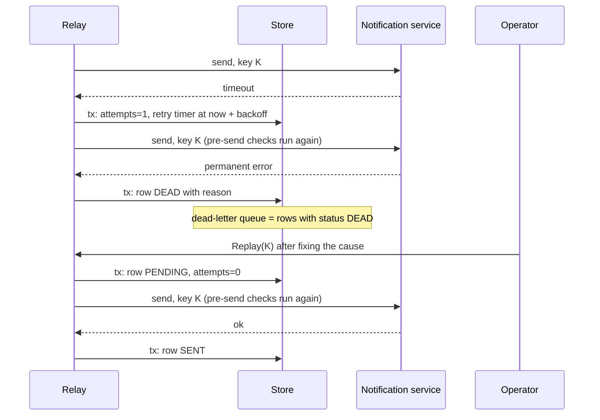

# Abandoned-cart recovery: design

Detail that supports this document (full assumptions table, capacity estimate,
benchmark numbers, more rejected alternatives) is in [APPENDIX.md](APPENDIX.md).

## 1. Summary

Shoppers add items to a cart and leave. This system notices when a cart has been
idle for a configurable window (default 30 minutes) and schedules reminders at
configurable offsets (default 30 minutes, 1 hour, 24 hours). It stops as soon as
the cart is purchased, cleared or resumed. Peak load is about 5,000 cart events
per second, with spikes above that.

The design is event-driven. Cart events flow through a log partitioned by cart
id into a state machine with a single writer per partition. Each cart has one
durable inactivity timer; when it fires and the cart is still idle, the cart is
marked abandoned and one reminder timer per offset is written. A fired reminder
becomes a row in a transactional outbox, and a relay delivers it to the
notification service after a final check against the order service.

Four decisions carry the design:

1. **One transactional store** for cart state, timers, outbox and dedupe keys,
   so a state change and its side effects commit together or not at all.
2. **Cancellation by generation, not deletion.** Every applied cart event bumps
   the cart's generation; timers and reminders carrying an older one are
   ignored.
3. **Idempotency at every hop**, because every hop delivers at least once.
4. **Delay, never drop, under load**, with lateness bounded: a reminder too late
   to be useful is suppressed and recorded, not sent.

The repository implements this pipeline in process, on in-memory adapters, with
a fake clock. It does not send anything. What is built and what is only
designed is stated in the README's known limitations and in section 12.

## 2. Assumptions and clarifying questions

The six assumptions that change the design most. Each is a question I would ask;
the full list, with what changes if the answer differs, is in
[Appendix A](APPENDIX.md#a-assumptions-and-clarifying-questions).

- **Offsets are measured from abandonment**, not from last activity. The first
  reminder is therefore 60 minutes after the last activity. Config-only to
  change: offsets `[0, 30m, 23h30m]` anchor on last activity.
- **A cart view counts as resuming.** It cancels pending reminders and restarts
  the inactivity clock. Only an item edit reopens a cleared cart.
- **The storefront emits `CartCleared`** when the last item is removed. The
  engine does not track item counts.
- **The order service is authoritative and queryable by cart id.** The pre-send
  check depends on it.
- **The notification service dedupes on the idempotency key.** Channels,
  consent and unsubscribe are also its job; the pipeline sends ids, never
  addresses.
- **Inactivity runs on server ingest time**, not the client's `occurredAt`.
  That makes replay deterministic and avoids a clock-skew rule.

## 3. Success and guardrail metrics (requirement 1)

**What success means.** Not "recovered carts". Many shoppers come back on their
own, so counting purchases after a reminder credits the system with sales it did
not cause. Success is the *incremental* effect of reminding.

**Control group.** A fixed share of shoppers is held out. The pipeline treats
them identically up to the last step: it detects abandonment, schedules
reminders, runs every pre-send check, then records `Suppressed(holdout)` instead
of sending. Because the holdout decision is the last gate, the record means "a
treated shopper in this exact state would have been sent this reminder", which
gives like-for-like populations. Assignment is a salted hash of the shopper id:
stable across carts and restarts, and needing no storage.

- **Primary:** incremental conversion, `P(order within 7 days of abandonment)`
  for treated minus holdout, and incremental revenue per abandoning shopper,
  analysed per shopper since one shopper's carts are correlated.
- **Secondary:** time from abandonment to purchase; click-through per reminder;
  contribution of each offset (does the 24-hour reminder add anything?).

**Signals of harm (guardrails).** Any of these halts the ramp.

| Guardrail | Why it matters | Target |
|---|---|---|
| Reminders sent for purchased carts; duplicate reminders | Correctness failures, visible to shoppers | 0 |
| Unsubscribe and spam-complaint rate, treated vs holdout | Complaints damage sender reputation for all email | No significant rise |
| 30- and 90-day repeat purchase rate, treated vs holdout | Annoyed shoppers churn after the experiment window | No significant drop |
| Share of suppressed-late (`stale`, `retry_deadline`) and dead-lettered reminders | The system is failing quietly | Alert above a small baseline |
| Margin, if reminders carry discounts | Shoppers learn to abandon on purpose | Incremental margin stays positive |

**Experiment design.** For a two-sided test at 5% significance and 80% power,
with baseline rate `p`, minimum detectable absolute lift `d` and holdout share
`h`, the shoppers needed are about `n = (1.96 + 0.84)^2 * p(1-p) / (d^2 * h(1-h))`
(worked numbers, illustrative: Appendix B). Start at 50/50 to learn fast, then
shrink to a permanent 5 to 10% holdout so the effect keeps being measured. Run
at least two full weeks plus the 24-hour offset plus the 7-day attribution
window.

**Rollout.** Shadow mode first (holdout at 100%: everything computed and
journalled, nothing sent) to validate detection volume and the guardrail
counters on real traffic. Then 50/50, then ramp. `HoldoutPercent` is the kill
switch: 100 stops all sends without stopping the pipeline.

## 4. Architecture

A fired timer does not touch cart state directly. The timer worker publishes a
fire message to the cart's partition, so the same single writer that applies
events also applies timers. There is no concurrent writer to race with, and a
timer can never overtake an event still queued in the partition.

**In code,** the scheduler calls the engine directly rather than through the
log. What stands in for the single writer is the store's lock, which serialises
every engine write, from log events and timer fires alike. The pipeline's own
mutex only orders log consumption. Routing fires through the log is designed,
not built.

**Detection, then firing with cancellation checks**

**Send failure, dead-letter, replay**

## 5. Detection: event-driven, not batch (requirement 2)

| | Event-driven (chosen) | Periodic batch scan |
|---|---|---|
| Latency to detection | The timer's due time, plus scheduler lag (seconds) | Up to one scan interval. A 5-minute scan puts the 30-minute reminder anywhere from 30 to 35 minutes. |
| Cost | Proportional to activity: one write per event, one timer per cart | Proportional to table size on every scan, including carts that have not changed |
| "An edit resets the clock" | Exact. Event and timer go through one writer, in order. | Racy. An edit can land between the scan reading a cart and acting on it; needs the same generation check to be safe. |
| Operational shape | More parts: a log, timers, an outbox | One job and one table. Simpler to run. |

Batch is right at low volume or where reminders may be minutes late. At 5,000
events per second with a 30-minute first reminder, the scan either runs often
and costs the most, or runs rarely and is late.

**One timer per cart.** A cart has at most one armed inactivity timer, and an
edit only updates `lastActivity`. When the timer fires, the engine compares: if
the cart was edited since, it re-arms for `lastActivity + window`; otherwise the
cart is abandoned. Timer writes scale with carts, not events, and detection is
still exact to the timer's resolution.

## 6. Mid-flight cancellation (requirement 3)

Reminders are cancelled by making them irrelevant. Three checks, each narrower
in time than the last:

1. **At timer fire (engine).** The reminder timer carries the generation it was
   scheduled under. If the cart's generation differs, or the cart is no longer
   `ABANDONED`, nothing is written. This catches every purchase, clear, edit or
   view the pipeline has consumed.
2. **Before send, local (relay).** The same check again against current state,
   catching a change that arrived while the row waited in the outbox, for
   instance during retry backoff.
3. **Before send, authoritative (relay).** The relay asks the order service
   whether the cart was purchased, catching the purchase whose event is still in
   flight. If the service cannot answer, the relay fails closed and retries. When
   the call returns, the relay reads the clock and the cart once more, so a slow
   check cannot send a stale reminder and a cart change committed during the call
   cancels the trigger.

The staleness bound decides whether to *start* a send, not how long the call may
take: that is the notification client's timeout (a few seconds in production, an
assumption). A send started inside the bound and accepted after it counts as
sent, stamped when the call returned.

**The residual race.** A shopper can complete a purchase after check 3 passes
and before the message reaches them: the time from the check to the provider's
handoff, milliseconds to a few seconds. It cannot reach zero, because an email
cannot be recalled. It could be narrowed by repeating the check at render time
in the notification service, and softened with copy ("already ordered? ignore
this"). I would measure "reminders sent for purchased carts" before spending
more on it.

## 7. Idempotency and delivery (requirement 4)

Every hop is at-least-once, so every hop has a key.

| Hop | Duplicate source | Defence |
|---|---|---|
| Log to state | Producer retries, consumer redelivery, deliberate replay | The event id is recorded in the same transaction as the state change. A seen id is skipped. |
| Timer to outbox | Timer worker crash between fire and delete | Outbox key `cartId:generation:offsetIndex`, inserted only if absent, in the same transaction as the check. The generation keeps a new cycle's reminders distinct from the old one's. Timer ids are deterministic, so re-adding one is a no-op. |
| Outbox to notification service | Crash or lost response between send and marking `SENT` | The same key travels with the trigger; the service drops repeats. |

The first two hops are exactly-once in effect because the dedupe record and the
effect commit atomically. That is why the store must be one transactional store:
with timers in Redis and state elsewhere, a crash between the two writes loses a
timer or leaves an orphan.

The last hop crosses a system boundary, so it cannot be atomic. It is
at-least-once plus an idempotent receiver. That is the honest meaning of
"effectively once" here, and it depends on the notification service honouring
the key. Several relays may drain the same outbox: in production each claims a
row first (a lease, or `SELECT ... FOR UPDATE SKIP LOCKED`) so the provider is
not called twice, and the key is the backstop when a claim lapses. The
in-process relay does not claim rows; a test shows two relays sending the same
row are deduplicated by the key.

**Retention.** Dedupe records must outlive anything that could resend: event ids
at least the log's retention (the replay horizon); outbox rows and the
notification service's key memory longer than the largest offset (24 hours) plus
that horizon. The in-memory store keeps everything; expiry is not implemented.

## 8. Failure handling (requirement 5)

| What fails | Detected by | Effect | Recovery |
|---|---|---|---|
| Ingest API saturated | Produce latency, queue depth | New events rejected with 429; producers retry | Autoscale. Nothing accepted is lost. |
| Event log unavailable | Produce errors | Ingest returns 503; events buffer at the producer | Events arrive late but stamped at append, so the inactivity clock starts late rather than wrong. |
| Engine consumer crashes | Consumer lag | That partition pauses; reminders are late | Restart resumes from the committed offset. Reprocessed events are skipped by id. |
| Store unavailable | Transaction errors | Consumers and timer workers stall and retry. Nothing is acknowledged. | Catch up on recovery. Reminders past the staleness bound are suppressed. |
| Timer worker crashes | Timer lag (now minus oldest due timer) | Timers fire late | Another worker claims the shard. Timers are rows, so none are lost. A re-fired timer is harmless. |
| Order service down | Pre-send check errors | No sends (fail closed); fresh rows retry with backoff | Automatic if it recovers within the bound. Otherwise suppressed (`retry_deadline`). |
| Notification service: transient error | Send error | Retry with exponential backoff and jitter | Automatic if it recovers within the bound. Otherwise suppressed (`retry_deadline`). |
| Notification service: permanent error | Error class | Dead-lettered at once with the reason | Fix the cause, then replay. |

**Retry policy.** Delay doubles from 1 second to a 5-minute cap. Jitter picks a
point in the upper half of each delay, so a burst of failures does not retry in
step. The retry is a durable timer, not a sleeping goroutine, so it survives a
restart. Backoff is measured from when the failed call returned.

**Retry budget.** A reminder is worth sending until the staleness bound
(`MaxLateness`, 30 minutes after its due time), so that, not a fixed number of
tries, is the budget. How retries end depends on whether a person could still
act:

| Situation | Outcome |
|---|---|
| A call fails after `DueAt + MaxLateness` has passed (any attempt count) | Suppressed, `stale` |
| The next attempt would land past `DueAt + MaxLateness` | Suppressed, `retry_deadline` |
| `MaxAttempts` (20) reached inside the bound, or a permanent error | Dead-lettered, with the reason |

The DLQ only holds items a human can fix in time; lateness is a metric, not a
ticket. `MaxAttempts` is a safety valve against a misconfigured backoff, not the
intended limit: at the defaults, twenty attempts span about 29 to 58 minutes, so
the bound is what stops retries. A transient outage that ends within the bound
recovers on its own, with no dead letter and no operator. If `BackoffMax` or
`MaxLateness` changes, recheck `MaxAttempts` against that span.

**Replay.** For one dead-lettered reminder: read the reason, fix the cause, call
`Replay(key)`. All pre-send checks run again, so a replay after the cart was
purchased is cancelled and one past the bound is suppressed; a key that is not
`DEAD` is refused, so replaying twice sends once. To re-process a range of the
log, reset the consumer's offset: applied events are skipped by id. Replay never
needs judgement about whether it is safe. That is what idempotency buys.

**Head-of-line blocking.** In this single-process version one persistently
failing timer holds every timer behind it. Production shards timers (a lease and
worker per shard) and quarantines a timer after N consecutive failures, journalled
and alerted on. Neither is built.

**Operating signals.** Timer lag and consumer lag (reminders are late);
dead-letter count by reason; suppressed-late rate; a proposed SLO of 99% of
reminders handed over within 60 seconds of their due time, to be set from
production data.

## 9. Secondary topics

**Load spikes: delay, do not drop.** The log absorbs a spike as consumer lag.
Correctness survives the delay because the inactivity clock runs on append time
and timers queue behind events in the partition; a reminder at 31 minutes
instead of 30 is fine. Dropping is not safe: a dropped `OrderPlaced` becomes a
reminder to a customer who paid. Reject (429) only at the ingest edge, when the
log itself cannot accept writes, so the producer still holds the event. A
reminder delayed past `MaxLateness` is suppressed and counted, not sent stale.

**Guest carts.** Recommend merge on login: the guest cart's items move into the
user's cart, the guest cart gets a terminal event that voids its reminders, and
the user's cart starts one fresh cycle. Discarding loses the most recent intent
the shopper showed; keeping both sends two sets of reminders. The merge is not
implemented. If the storefront keeps one cart id across login, the engine
upgrades the cart's identity to the user id on the first event that carries one.
An event naming a different user than the cart's is marked seen, journalled as an
identity conflict and not applied, so a foreign event cannot reset the owner's
activity or cancel their reminders.

**Experiment assignment: user id or session id.** User id is stable across
devices but does not exist for guests. Session id covers guests but splits one
person across devices, leaking treatment into control and biasing measured lift
toward zero. The code hashes the cart's current shopper id, so a guest who later
logs in can switch groups; a production experiment should persist assignment
against a stable first-party identity. Timing and message variants would use
more hash buckets; neither is implemented.

**Personalisation.** The notification service renders greeting and cart contents
at send time from the cart id: current prices and stock, and no names, addresses
or cart contents in this pipeline's store, so erasure touches only id-keyed rows.

**Quiet hours and frequency caps** belong in the relay as pre-send checks,
recorded as `Suppressed`. Quiet hours should defer to the end of the window
unless that breaches the staleness bound. A cart view restarts the cycle, so a
browsing shopper could trigger repeated cycles; a per-shopper daily cap across
carts is the control. Neither is implemented.

## 10. Production mapping

| In code | In production |
|---|---|
| `pipeline` log (a slice) | Kafka topic keyed by cart id, broker append-time timestamps |
| `store.Store` (maps, one mutex) | DynamoDB (transactional writes) or Postgres partitioned by cart id; one table each for carts, seen events, timers, outbox; TTL on all |
| `scheduler` (one wake-up on a clock) | Workers polling `timers` by `(shard, due)` with a lease per shard, publishing fire messages to the log |
| `delivery.Relay` | Outbox poller, or change-data-capture on the outbox table |
| `notifier.Stub`, `notifier.Orders` | The notification and order services |

The store is the bottleneck: one transaction per event, about 5,000 per second at
peak, which is why it is partitioned by cart id. The capacity estimate and the
one benchmark (engine CPU cost only, not production throughput) are in
[Appendix B](APPENDIX.md#b-capacity-estimate-and-benchmark).

## 11. Decisions and rejected alternatives

The decisions a reviewer is most likely to probe. More are in
[Appendix C](APPENDIX.md#c-more-rejected-alternatives).

| Decision | Rejected | Why |
|---|---|---|
| Event-driven detection | Batch scan | Latency, scan cost and the edit race (section 5) |
| Cancel by generation | Delete timers on purchase | Deletion races with firing and needs its own retry path; a generation check cannot miss |
| One transactional store | Redis for timers, separate state store | No atomic commit across the two |
| Timer fires go through the cart's partition | Timer worker updates state directly | A second writer; timers could overtake lagging events |
| Outbox plus idempotent receiver | Send inside the engine transaction | A slow send would hold the partition; a crash would lose or repeat it |
| Delay under load, bounded by staleness | Drop or sample events | A dropped purchase event becomes a wrong reminder |

## 12. With more time

- A Postgres adapter behind the store's method set, running the same scenario
  suite. That is the real test of the transactional claims.
- A load test with consumer lag injected, to measure timer lag and suppressed
  rates under a spike. There is no load harness; the capacity numbers are
  estimates.
- Frequency cap, quiet hours with deferral, and guest merge; TTL and compaction
  for dedupe records.
- A property test over random event interleavings asserting the invariants: no
  reminder after purchase, no duplicate key delivered.
