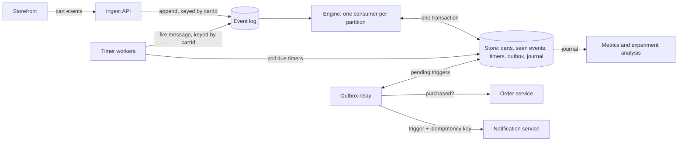
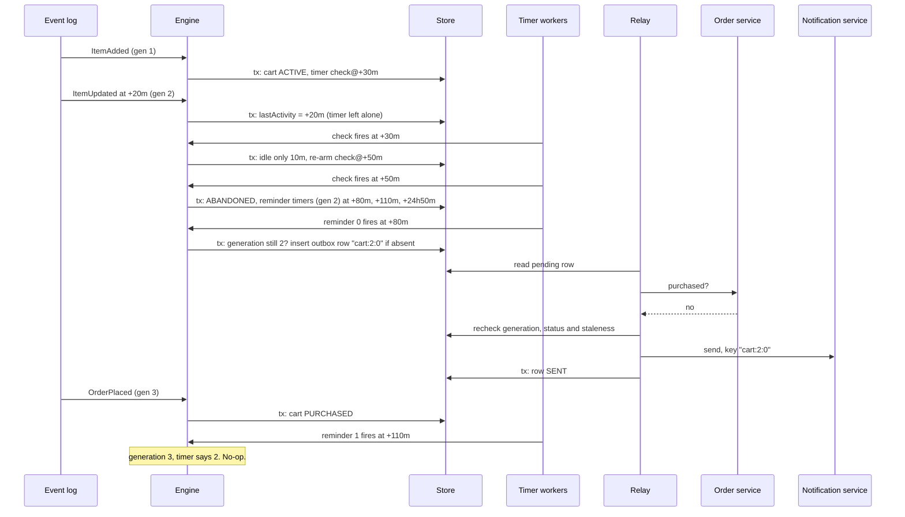
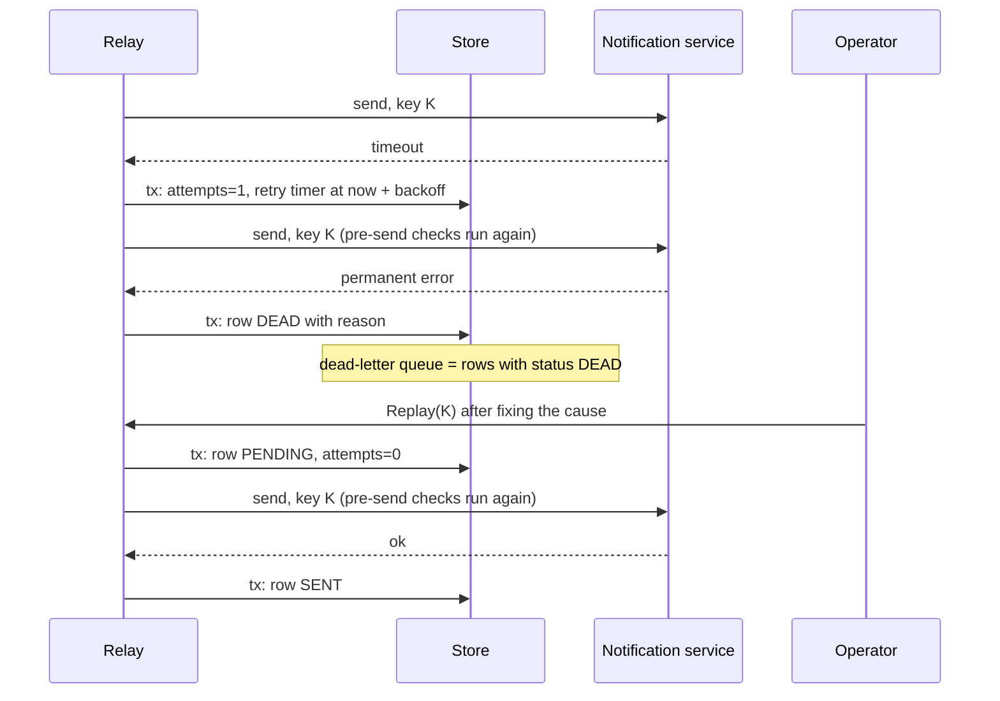

# Abandoned-cart recovery: design

## 1. Summary

Shoppers add items to a cart and leave. This system notices when a cart has been
idle for a configurable window (default 30 minutes) and schedules reminders at
configurable offsets (default 30 minutes, 1 hour, 24 hours). It stops as soon as
the cart is purchased, cleared or resumed. Peak load is about 5,000 cart events
per second, with spikes above that.

The design is event-driven. Cart events flow through a log partitioned by cart
id into a state machine with a single writer per partition. Each cart has one
durable inactivity timer; when it fires and the cart is still idle, the cart is
marked abandoned and one reminder timer per offset is written. A fired reminder
becomes a row in a transactional outbox, and a relay delivers it to the
notification service after a final check against the order service.

Four decisions carry the design:

1. **One transactional store** for cart state, timers, outbox and dedupe keys,
   so a state change and its side effects commit together or not at all.
2. **Cancellation by generation, not deletion.** Every applied cart event
   increments the cart's generation. Timers and reminders carry the generation
   they were created under and are ignored once it changes. Nothing is hunted
   down and deleted.
3. **Idempotency at every hop**, because every hop delivers at least once:
   event id into state, a deterministic key `cartId:generation:offsetIndex`
   into the outbox, and the same key into the notification service.
4. **Delay, never drop, under load.** Reminders tolerate lateness; a dropped
   `OrderPlaced` does not. Lateness is bounded: a reminder too late to be
   useful is suppressed and recorded, not sent.

The repository implements this pipeline in process, on in-memory adapters, with
a fake clock. It does not send anything.

## 2. Assumptions and clarifying questions

Each row is a question I would ask, the default I built on, and what changes if
the answer differs.

| Question | Assumed default | If wrong |
|---|---|---|
| Are offsets measured from abandonment or from last activity? | From abandonment (last activity + window). First reminder is 60 minutes after the last activity. | Config only: offsets `[0, 30m, 23h30m]` give last-activity anchoring. Zero is a valid offset. |
| Does "resumed" include viewing the cart? | Yes. A view cancels pending reminders and restarts the inactivity clock. | If only edits count, drop `CartResumed` from the activity set. One line. |
| How does the engine learn the cart is empty? | The storefront emits `CartCleared` when the last item is removed. The engine does not track item counts. | A cart emptied by `ItemRemoved` alone would still be reminded. Either fix the producer or give the engine an item count. |
| Is `CheckoutStarted` an outcome? | No. It is activity. An abandoned checkout is the most valuable cart to remind. | If it should stop reminders, treat it like `OrderPlaced`. |
| Which timestamp drives inactivity? | Server ingest time (the log's append time), not the client's `occurredAt`. | Client time would need an out-of-order tolerance rule and clock-skew bounds. |
| Does a cart id survive a purchase? | No. A purchase is terminal; the next journey gets a new cart id. | Reopen on `ItemAdded`, as already done for cleared carts. |
| Is the order service authoritative and queryable by cart id? | Yes. Required for the pre-send check. | Without it the residual race in section 6 widens to the event log's lag. |
| Does the notification service dedupe on an idempotency key? | Yes, for at least the retention in section 7. | Otherwise delivery is at-least-once, with rare duplicates after a lost response. |
| Channels, consent, unsubscribe? | Owned by the notification service. The pipeline sends ids, never addresses. | Consent checks would move into the relay's pre-send checks. |
| Can guests be contacted? | Only if an email or push token was captured; the notification service decides. | No change here; unreachable shoppers are dropped downstream. |
| Per-shopper frequency cap and quiet hours? | Wanted, not built. Section 9. | n/a |
| Retention and privacy? | Cart rows expire 30 days after the last activity. Store holds ids only. | Shorter retention shortens the replay horizon. |

## 3. Success and guardrail metrics (requirement 1)

**What success means.** Not "recovered carts". Many shoppers come back on their
own, so counting purchases after a reminder credits the system with sales it did
not cause. Success is the *incremental* effect of reminding.

**Control group.** A fixed share of shoppers is held out. The pipeline treats
them identically up to the last step: it detects abandonment, schedules
reminders, runs every pre-send check, then records `Suppressed(holdout)` instead
of sending. Because the holdout decision is the last gate, the record means "a
treated shopper in this exact state would have been sent this reminder". That
gives like-for-like populations on both sides. Assignment is a salted hash of
the shopper id: stable across carts and restarts, and needing no storage.

- **Primary:** incremental conversion, `P(order within 7 days of abandonment)`
  for treated minus holdout, and incremental revenue per abandoning shopper.
  Randomised and analysed per shopper, since one shopper's carts are correlated.
- **Secondary:** time from abandonment to purchase; click-through per reminder;
  contribution of each offset (does the 24-hour reminder add anything after the
  first two?).

**Signals of harm (guardrails).** Any of these halts the ramp.

| Guardrail | Why it matters | Target |
|---|---|---|
| Reminders sent for purchased carts | Correctness failure, visible to shoppers | 0 |
| Duplicate reminders | Same | 0 |
| Unsubscribe and spam-complaint rate, treated vs holdout | Complaints damage sender reputation for all email, not just reminders | No significant rise |
| 30- and 90-day repeat purchase rate, treated vs holdout | Annoyed shoppers churn later than the experiment window | No significant drop |
| Share of suppressed-late (`stale`, `retry_deadline`) and dead-lettered reminders | The system is failing quietly | Alert above a small baseline |
| Margin, if reminders carry discounts | Shoppers learn to abandon on purpose | Incremental margin, not revenue, stays positive |

**Experiment design.** For a two-sided test at 5% significance and 80% power,
with baseline rate `p`, minimum detectable absolute lift `d` and holdout share
`h`, the number of abandoning shoppers needed is approximately

```
n = (1.96 + 0.84)^2 * p * (1 - p) / (d^2 * h * (1 - h))
```

*Illustrative numbers, not measurements:* `p = 10%`, `d = 1` point, `h = 10%`
gives about 78,400 shoppers; `h = 50%` gives about 28,000. Start at 50/50 to
learn fast, then shrink the holdout to a permanent 5 to 10% so the effect keeps
being measured as the system and the season change. Run for at least two full
weeks plus the 24-hour offset plus the 7-day attribution window.

**Rollout.** Shadow mode first (holdout at 100%: everything is computed and
journalled, nothing is sent) to validate detection volume and the guardrail
counters against real traffic. Then 50/50, then ramp. `HoldoutPercent` is the
kill switch: setting it to 100 stops all sends without stopping the pipeline.

## 4. Architecture



A fired timer does not touch cart state directly. The timer worker publishes a
fire message to the cart's partition, so the same single writer that applies
events also applies timers. Two consequences: there is no concurrent writer to
race with, and a timer can never overtake an event that is still queued in the
partition. Under consumer lag, the fire message waits behind the shopper's
latest edit and sees it.

In code, `internal/pipeline` wires the same components in one process, and the
scheduler calls the engine directly rather than through the log. What stands in
for the single writer is the store's lock: it serialises every engine write,
whether it comes from a log event or from a timer fire. The pipeline's own mutex
only orders log consumption. Routing timer fires through the log is designed,
not built.

**Detection, then firing with cancellation checks**



**Send failure, dead-letter, replay**



## 5. Detection: event-driven, not batch (requirement 2)

| | Event-driven (chosen) | Periodic batch scan |
|---|---|---|
| Latency to detection | The timer's due time, plus scheduler lag (seconds) | Up to one scan interval. A 5-minute scan makes the 30-minute reminder land anywhere from 30 to 35 minutes. |
| Cost | Proportional to activity: one write per event, one timer per cart | Proportional to table size on every scan, including carts that have not changed. Needs an index on last activity, written on every event anyway. |
| "An edit resets the clock" | Exact. The event and the timer go through one writer, in order. | Racy. An edit can land between the scan reading a cart and acting on it. Needs the same generation check to be safe. |
| Operational shape | More parts: a log, timers, an outbox | One job and one table. Simpler to run. |

Batch is the right answer at low volume or where reminders may be minutes late.
At 5,000 events per second with a 30-minute first reminder, the scan either
runs often and costs the most, or runs rarely and is late. And the batch design
still needs generation checks for correctness, so its simplicity is partly an
illusion.

**One timer per cart.** The obvious event-driven design writes a new timer on
every event. This one does not. A cart has at most one armed inactivity timer.
An edit only updates `lastActivity`. When the timer fires, the engine compares:
if the cart was edited since, it re-arms for `lastActivity + window`; otherwise
the cart is abandoned. Timer writes scale with carts, not events, and detection
is still exact to the timer's resolution.

## 6. Mid-flight cancellation (requirement 3)

Reminders are cancelled by making them irrelevant. Three checks, each narrower
in time than the last:

1. **At timer fire (engine).** The reminder timer carries the generation it was
   scheduled under. If the cart's generation differs, or the cart is no longer
   `ABANDONED`, nothing is written. This catches every purchase, clear, edit or
   view the pipeline has consumed.
2. **Before send, local (relay).** The same generation check again, against
   current state. This catches a change that arrived while the row waited in
   the outbox, for instance during retry backoff.
3. **Before send, authoritative (relay).** The relay asks the order service
   whether the cart was purchased. This catches the purchase whose event is
   still in flight. If the order service cannot answer, the relay fails closed:
   it retries while the reminder is fresh, and suppresses it if the check
   returns after the staleness bound. After a successful check, it reads the
   clock and cart again before sending. A slow check cannot send a stale
   reminder, and a cart change committed during the call cancels the trigger.
   The bound decides whether to start the send, not how long the call may take:
   that is the notification client's timeout (a few seconds in production, an
   assumption). A send started inside the bound and accepted after it counts as
   sent, stamped with the time the call returned; a failed one measures its
   backoff from then.

**The residual race.** A shopper can complete a purchase after check 3 passes
and before the message reaches them. The window is the time from the check to
the provider handing off the message: milliseconds to a few seconds. It cannot
reach zero, because an email cannot be recalled. It could be narrowed by having
the notification service repeat the check at render time, and softened with
copy ("already ordered? ignore this"). I would measure the guardrail "reminders
sent for purchased carts" before spending more on it.

## 7. Idempotency and delivery (requirement 4)

Every hop is at-least-once, so every hop has a key.

| Hop | Duplicate source | Defence |
|---|---|---|
| Log to state | Producer retries, consumer redelivery, deliberate replay | The event id is recorded in the same transaction as the state change. A seen id is skipped. |
| Timer to outbox | Timer worker crash between fire and delete | The outbox key is `cartId:generation:offsetIndex`, inserted only if absent, in the same transaction as the check. Timer ids are deterministic, so re-adding one is a no-op. |
| Outbox to notification service | Crash or lost response between send and marking `SENT` | The same key travels with the trigger; the service drops repeats. |

The first two hops are exactly-once in effect because the dedupe record and the
effect commit atomically. This is why the store must be one transactional
store: with timers in Redis and state elsewhere, a crash between the two writes
loses a timer or leaves an orphan.

Several relays may drain the same outbox. In production each claims a row
before sending (a lease, or `SELECT ... FOR UPDATE SKIP LOCKED`) so the
provider is not called twice. The key is the backstop when a claim lapses. The
in-process relay does not claim rows, and a test shows two relays sending the
same row are deduplicated by the key.

The last hop crosses a system boundary, so it cannot be atomic. It is
at-least-once plus an idempotent receiver. That is the honest meaning of
"effectively once" here, and it depends on the notification service honouring
the key.

**Retention.** Dedupe records must outlive anything that could resend. Event
ids: at least the log's retention, since that is the replay horizon. Outbox
rows and the notification service's key memory: longer than the largest offset
(24 hours) plus the replay horizon. With 7-day log retention, 9 days. The
in-memory store keeps everything; expiry is not implemented.

**Why the generation is in the key.** An edit after abandonment starts a new
cycle with a new generation. Its reminders are different reminders and must not
be deduplicated against the old cycle's.

## 8. Failure handling (requirement 5)

| What fails | Detected by | Effect | Recovery |
|---|---|---|---|
| Ingest API saturated | Produce latency, queue depth | New events rejected with 429; producers retry | Autoscale. Nothing accepted is lost. |
| Event log unavailable | Produce errors | Ingest returns 503; events buffer at the producer | Events arrive late but stamped at append, so the inactivity clock starts late rather than wrong. |
| Engine consumer crashes | Consumer lag | That partition pauses; reminders are late | Restart resumes from the committed offset. Reprocessed events are skipped by id. |
| Store unavailable | Transaction errors | Consumers and timer workers stall and retry. Nothing is acknowledged. | Catch up on recovery. Reminders past the staleness bound are suppressed. |
| Timer worker crashes | Timer lag (now minus oldest due timer) | Timers fire late | Another worker claims the shard. Timers are rows, so none are lost. A re-fired timer is harmless. |
| Order service down | Pre-send check errors | No sends (fail closed); fresh rows retry with backoff, expired rows are suppressed | Automatic if it recovers within the bound. Otherwise suppressed (`retry_deadline`); dead-lettered only if the safety-valve cap is hit first. |
| Notification service: transient error | Send error | Retry with exponential backoff and jitter within the retry budget | Automatic if it recovers within the bound. Otherwise suppressed (`retry_deadline`). |
| Notification service: permanent error | Error class | Dead-lettered at once with the reason. Retrying cannot help. | Fix the cause, then replay. |

**Retry policy.** Delay doubles from 1 second to a 5-minute cap. Jitter picks a
point in the upper half of each delay, so a burst of failures does not retry in
step and no retry is immediate. The retry is a durable timer, not a sleeping
goroutine, so it survives a restart.

**Retry budget.** A reminder is worth sending until the staleness bound
(`MaxLateness`, 30 minutes after its due time), so that, not a fixed number of
tries, is the budget. Retries end at whichever comes first of two limits, and
they end differently:

- A call fails after `DueAt + MaxLateness` has already passed, whatever the
  attempt count: the reminder is **suppressed** as `stale`. This is checked
  first, so a slow failure on the cap attempt cannot dead-letter an expired
  reminder.
- The next attempt would land past `DueAt + MaxLateness`: the reminder is
  **suppressed** with reason `retry_deadline` and journalled. It is counted
  with suppressed-stale.
- `MaxAttempts` (20) is reached while still inside the bound: the reminder is
  **dead-lettered** with the reason. The cap is a safety valve against a
  misconfigured backoff or a tight retry loop, not the intended limit.

The DLQ only holds items a human can fix in time; lateness is a metric, not a
ticket. A reminder past its bound cannot be rescued by anyone, so it never
enters the queue. Dead letters are therefore permanent errors, or the safety
valve tripping.

With the defaults (1 second doubling to a 5-minute cap, jitter in the upper
half) twenty attempts span 3,511 seconds before jitter and 50 to 100% of that
after it: about 29 to 58 minutes. That reaches the 30-minute bound for all but
the lowest jitter draws, so under the defaults the bound is the limit. A
transient outage of the order service or the notification service that ends
within the bound recovers on its own, with no dead letter and no operator. One
that outlasts the bound ends in `retry_deadline` suppressions, visible as a
metric. If `BackoffMax` or `MaxLateness` is changed, `MaxAttempts` must be
rechecked against this span, or the cap will start to bind first.

**Head-of-line blocking in the scheduler.** In this single-process version the
scheduler fires timers in due order and holds the queue behind a timer whose
handler keeps failing, so one poisoned timer delays every timer behind it.
Production avoids this in two ways: timers are sharded, each shard has its own
lease and worker, so a failing timer stalls one shard and not all; and a timer
that fails N consecutive times is quarantined (moved aside, journalled with its
error, alerted on) so the shard moves on. Neither is built.

**Dead-letter queue.** A reminder that exhausts its attempts or fails
permanently becomes a `DEAD` outbox row carrying the reason. In production I
would also publish it to a DLQ topic for alerting.

**Replay runbook.**

- *One dead-lettered reminder:* read the reason, fix the cause, call
  `Replay(key)`. All pre-send checks run again, so a replay after the cart was
  purchased is cancelled, and a replay past the staleness bound is suppressed.
  A key that is not `DEAD` is refused, so replaying twice sends once.
- *A range of the log:* stop the consumer, reset its offset, restart. Events
  already applied are skipped by id; events that were lost to a bug are applied
  with their original ingest time.

Replay never needs judgement about whether it is safe. That is what
idempotency buys.

**Operating signals.** Timer lag and consumer lag (both mean reminders are
late); dead-letter count by reason; suppressed-late rate (`stale` plus
`retry_deadline`); and the SLO
"99% of reminders handed to the notification service within 60 seconds of
their due time" (a proposed target, to be set from production data).

## 9. Secondary topics

**Load spikes: delay, do not drop.** The log absorbs a spike as consumer lag.
Correctness survives the delay because the inactivity clock runs on append
time, not processing time, and timers queue behind events in the partition. A
reminder at 31 minutes instead of 30 is fine. Dropping is not safe: a dropped
`OrderPlaced` turns into a reminder to a customer who paid. Reject (429) only
at the ingest edge, only when the log itself cannot accept writes, so the
producer still holds the event. When delay exceeds `MaxLateness` (30 minutes),
the reminder is suppressed and counted, not sent stale.

**Guest carts.** Recommend merge on login. The guest cart's items move into the
user's cart; the guest cart receives a terminal event, which bumps its
generation and voids its reminders; the user's cart receives an item event and
starts one fresh cycle. Discarding the guest cart throws away the most recent
intent the shopper showed. Running both would send two sets of reminders. The
merge itself is not implemented.

If the storefront instead keeps the same cart id across login, the engine
upgrades the cart's identity to the user id on the first event that carries one,
so reminders are addressed to, and the holdout is decided on, the signed-in
shopper. The upgrade is one-way. An event naming a different user than the
cart's is not applied: it is marked seen and journalled as an identity conflict,
so a foreign event can neither reset the owner's activity nor cancel their
reminders. Skipping it does not stall the partition.

**Experiment assignment: user id or session id.** User id is stable across
devices but does not exist for guests. Session id covers guests but splits one
person across devices and sessions, which leaks treatment into control and
biases measured lift toward zero. The code hashes the cart's current shopper id
when it creates a reminder: a user id after login, otherwise the guest session
id. This is stable across that id's carts and retries, but a guest who later
logs in can receive a different assignment. For a production experiment that
must remain sticky across login, persist the assignment against a stable
first-party identity. Timing and message variants would use additional hash
buckets, with the variant id stored on the trigger; neither is implemented.

**Personalisation.** The notification service renders greeting and cart
contents at send time from the cart id. Rendering late means current prices and
stock, and it keeps names, addresses and cart contents out of this pipeline's
store and log. Erasure requests then touch only id-keyed rows.

**Quiet hours and frequency caps.** Both belong in the relay as pre-send
checks, recorded as `Suppressed` with a reason. For quiet hours I would defer
to the end of the quiet window, not suppress, unless that breaches the
staleness bound. Because a cart view restarts the cycle, a browsing shopper
could trigger repeated cycles; a per-shopper daily cap across carts is the
control. Neither is implemented.

## 10. Production mapping and capacity

| In code | In production |
|---|---|
| `pipeline` log (a slice) | Kafka topic keyed by cart id, broker append-time timestamps |
| `store.Store` (maps, one mutex) | DynamoDB (transactional writes) or Postgres partitioned by cart id. One table each for carts, seen events, timers, outbox; TTL on all. |
| `scheduler` (one wake-up on a clock) | Workers polling `timers` by `(shard, due)` with a lease per shard, publishing fire messages to the log |
| `delivery.Relay` | Outbox poller, or change-data-capture on the outbox table |
| `notifier.Stub`, `notifier.Orders` | The notification and order services |

Timer store alternatives: a Redis sorted set is fast but is a second system, so
state and timer cannot commit together. An in-memory hierarchical timing wheel
is the most efficient and loses everything on restart unless rebuilt from a
durable source, which is the timer table again. The table is the boring choice
that keeps atomicity.

**Capacity. These are design-time estimates, not measurements.**

- Ingest: 5,000 events/s at roughly 500 bytes is 2.5 MB/s; a 5x spike is
  12.5 MB/s. Well inside one small Kafka cluster.
- Store: one transaction per event, so 5,000 transactions/s at peak. This is
  the bottleneck and the reason to partition the store by cart id.
- Partitions: if one consumer sustains 1,000 to 2,000 transactions/s against
  the store (to be load-tested), peak needs 3 to 5. I would provision 64 for
  spike headroom and fine-grained rebalancing.
- Timers: assuming 6 events per cart and 70% abandonment, peak is about 830
  inactivity timers/s and 1,750 reminder timers/s.

**Measured.** The engine's hot path (dedupe check, transition, one in-memory
commit) takes about 820 ns per event on one core: `BenchmarkHandleEvent`,
811 to 823 ns/op over three runs, 7 allocations per event. Machine: Intel Core
i5-9600K 3.7 GHz, 6 cores, macOS (Darwin 24.6.0), Go 1.27.1. Command:
`make bench`. This shows only that the state machine's CPU cost is negligible
beside store I/O. It says nothing about production throughput.

## 11. Decisions and rejected alternatives

| Decision | Rejected | Why |
|---|---|---|
| Event-driven detection | Batch scan | Latency, scan cost, edit race (section 5) |
| One timer per cart, re-armed on fire | A timer per event | Timer writes scale with carts, not events |
| Cancel by generation | Delete timers on purchase | Deletion races with firing and needs its own retry path; a generation check cannot miss |
| One transactional store | Redis for timers, separate state store | No atomic commit across the two |
| Timer fires go through the cart's partition | Timer worker updates state directly | A second writer; timers could overtake lagging events |
| Server ingest time | Client `occurredAt` | No clock skew, no out-of-order rule; replay is deterministic |
| Dedupe by event id, per transaction | Per-cart sequence high-water mark | A high-water mark drops a late `OrderPlaced` |
| Outbox plus idempotent receiver | Send inside the engine transaction | A slow send would hold the partition; a crash would lose or repeat it |
| Holdout as the last pre-send check | Filter held-out shoppers at ingest | Would-have-sent records must mirror real sends exactly |
| Delay under load, bounded by staleness | Drop or sample events | A dropped purchase event becomes a wrong reminder |
| Dead letters as an outbox status | Separate queue only | Replay is a status change in the same store; no cross-system move |

## 12. With more time

- Postgres adapter behind the store's method set, and run the same scenario
  suite against it. That is the real test of the transactional claims.
- A load test with consumer lag injected, to measure timer lag and suppressed
  rates under a spike. The repository has no load harness; the numbers in
  section 10 are estimates.
- Frequency cap, quiet hours with deferral, and guest merge.
- TTL and compaction for dedupe records.
- A property test that generates random event interleavings and asserts the
  invariants: no reminder after purchase, no duplicate key delivered.
